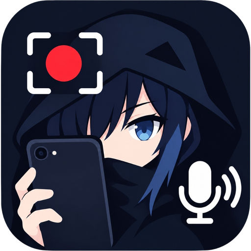
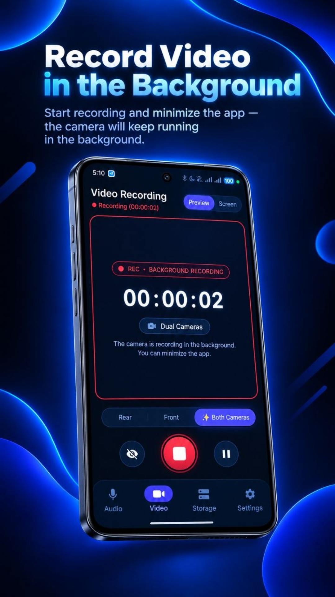
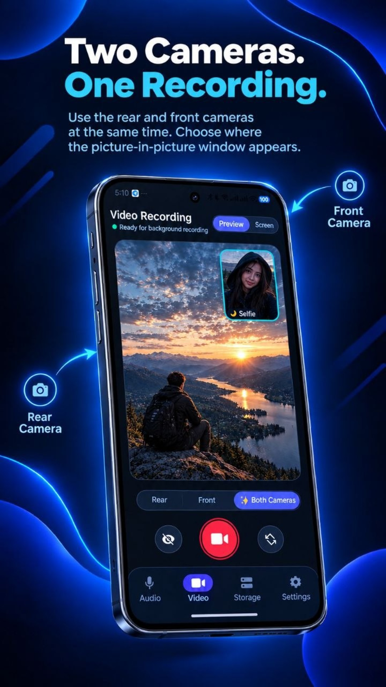
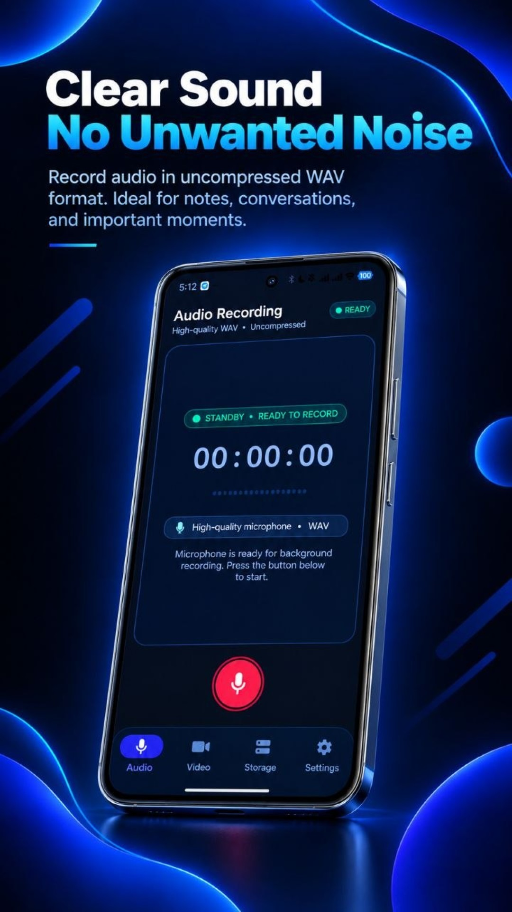
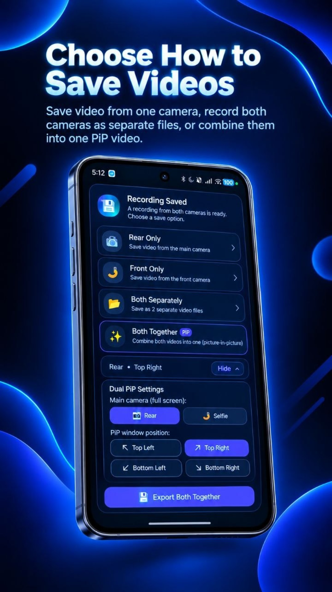
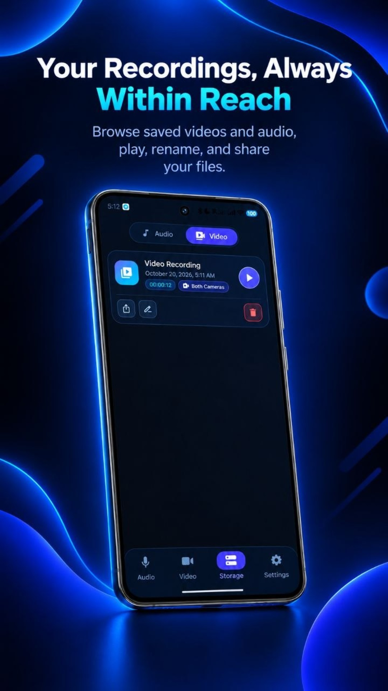
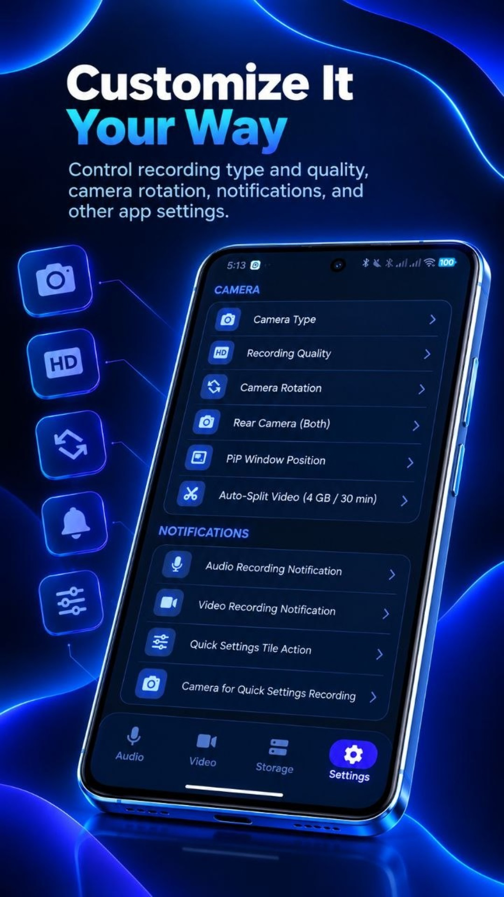

<p align="center">
  
</p>

<h1 align="center">✨ KageRec ✨</h1>

<p align="center">
  <b>Stealthy, reliable, and high-performance background video and audio recording for Android with hardware dual-camera support</b><br>
  <i>Скрытая, надежная и высокопроизводительная фоновая запись видео и аудио для Android с аппаратной поддержкой двух камер</i>
</p>

<p align="center">
  
  
  
  <a href="LICENSE"></a>
</p>

<p align="center">
  <a href="#-screenshots--скриншоты"><b>📱 Screenshots / Скриншоты</b></a> •
  <a href="#-kagerec-in-english"><b>🇬🇧 English Version</b></a> •
  <a href="#-kagerec-на-русском"><b>🇷🇺 Перейти к русской версии</b></a>
</p>

<p align="center">
  <a href="https://github.com/xXMRK888YTXx/KageRec/releases/latest">
    
  </a>
  <a href="https://github.com/xXMRK888YTXx/KageRec/releases">
    
  </a>
  <a href="https://github.com/xXMRK888YTXx/KageRec">
    
  </a>
</p>

---

<h2 align="center">📱 Screenshots / Скриншоты</h2>

<p align="center">
  
  
  
</p>
<p align="center">
  
  
  
</p>

---

# 🇬🇧 KageRec (In English)

## 💡 About The Project

**KageRec** is a professional Android application designed for covert, continuous, and highly stable background video and audio recording.

The application captures high-definition video even when the screen is locked/turned off, when multitasking between other apps, or during mobile gaming. With stealth notification masking, PIN and biometric security, hardware button triggers, intelligent audio focus management during phone calls, and hardware-accelerated dual-camera stitching, this tool provides an essential utility for documenting events and personal security. 🚀

> [!TIP]
> The app is completely offline and telemetry-free. All media files are stored locally in secure internal storage with an optional export to the public gallery.

---

## 🌟 Key Features

### 🎥 1. Stealth Background Video & Audio Capture
- **Screen-Off Operation:** Continuous high-definition video and uncompressed audio capture while the screen is turned off or while multitasking in other apps.
- **Hardware Button Triggers:** Fast and discreet recording launch using physical volume buttons without waking up the screen.
- **Versatile Capture Modes:** Rear camera, front camera, simultaneous Dual-Camera (PiP), or standalone uncompressed WAV audio recording.

### 🛡️ 2. App Lock Screen Protection (`FLAG_SECURE`)
- **Dynamic `FLAG_SECURE`:** When App Lock is active, secure window flags prevent screenshots and screen capture by third-party apps.
- **Recent Apps Masking:** When minimized (`onStop`), the app task thumbnail in Android's recent apps switcher is masked with a protected black screen.

### 🔋 3. Uninterrupted Recording with `PARTIAL_WAKE_LOCK`
- **Doze Mode Continuity:** `RecordVideoService` and `AudioRecordService` maintain a `PowerManager.WakeLock` with a 6-hour safety timeout.
- **Smooth Capture:** Prevents CPU sleep while the screen is locked, eliminating audio stuttering and dropped frames. Released cleanly on pause, stop, or service destroy.

### 💾 4. Dynamic Disk Space Guard (`freeSpace` / `StatFs`)
- **Pre-flight Checks:** Recording aborts with a clear notification if available storage is less than 200 MB for video or 50 MB for audio.
- **Active Recording Guard:** If storage falls below critical levels (100 MB for video, 20 MB for audio) during recording, the service gracefully finalizes the MP4/AMR container to prevent file corruption.

### 📞 5. Intelligent Call & Audio Focus Handling
- **Audio Focus Listener (`AudioManager.OnAudioFocusChangeListener`):** Recording automatically pauses when a cellular or VoIP call (Telegram, WhatsApp) begins, preventing microphone conflicts.
- **Automatic Resume:** Background recording seamlessly resumes once the call is concluded without data loss.

### 🎬 6. Built-in Video Player (`VideoPlayerScreen`)
- **Material 3 Overlay:** Semi-transparent gradient top bar with edge-to-edge support (`statusBarsPadding`).
- **One-Tap Back Navigation:** Quick return to the storage library.
- **File Metadata:** Clear display of active video filename.
- **Instant Sharing:** Direct export to Telegram, WhatsApp, or cloud services (`Intent.ACTION_SEND`).
- **Tap-to-Toggle:** Player controls fade smoothly on tap.

### 🔐 7. App Lock & Biometrics
- **Cryptographically Salted PIN:** Stored as a **SHA-256** hash in `DataStore Preferences`.
- **Biometric Authentication (BiometricPrompt):** Instant unlock using fingerprint or facial recognition.
- **Animated Lock Screen:** Pin-pad with brute-force feedback (shake animation and red error indicator).

### 📸 8. Hardware-Accelerated Dual Video Recording
- **Concurrent Camera Capture:** Simultaneous recording from primary rear and front lenses.
- **Hardware Encoding (`DualVideoCombiner`):** Direct hardware codec selection (`c2.qti`, `c2.exynos`, `c2.mtk`, `omx`) via `MediaCodecList` with VBR mode. Delivers 3–5x faster stitching with minimal thermal footprint.
- **Custom PiP Layouts:** Customizable primary camera assignment and picture-in-picture window placement.

### ⏳ 9. Automatic Video Chunk Splitting
- **FAT32 & SD Card Safe:** **4 GB / 30-minute** limits prevent file corruption when saving to external SD cards.
- **Seamless Rotation (`rotateChunk`):** Rotates chunks continuously without interrupting the service or resetting recording timers.

### 🎛️ 10. Quick Settings Tile
- **Status Bar Quick Tile:** Start and stop stealth recording directly from the Android Quick Settings shade with bidirectional status sync.

### 🔔 11. Notification Cloaking & OEM Compatibility
- **Disguised Channels:** Masquerades persistent notifications and icons as generic system utilities.
- **OEM Cache Workarounds:** Eliminates notification icon caching issues across Xiaomi MIUI/HyperOS, Samsung OneUI, Huawei EMUI, and BBK (ColorOS).

---

## 🛠️ Tech Stack

| Category | Technologies |
| :--- | :--- |
| **Language** | Kotlin 2.2 (KSP 2.2, Coroutines 1.10, Flows, Channels) |
| **UI Framework** | Jetpack Compose, Material 3, Navigation Compose |
| **Camera & Media** | CameraX 1.5 (VideoCapture, ConcurrentCamera), MediaCodec, MediaRecorder, ExoPlayer 1.8 |
| **Architecture** | Multi-Module Clean Architecture, MVVM + MVI-like StateFlows |
| **Dependency Injection** | Dagger 2 |
| **Local Storage** | Room Database (KSP), DataStore Preferences |
| **Security** | AndroidX Biometric, WindowManager FLAG_SECURE, SHA-256 Key Salting |
| **System Services** | Foreground Service, SensorManager, AudioFocus, Quick Settings Tile |

---

## 📁 Modular Architecture

```text
├── app/                              # Main application module, Dagger DI, AppLock, MainActivity
├── CoreAndroid/                      # Base utilities, NotificationHelper, context extensions
├── CoreCompose/                      # Common Compose components, design system, themes
├── RecordVideoScreen/                # Video recording control screen and viewfinder
├── RecordAudioScreen/                # Audio recording control screen
├── RecordVideoService/               # Background Foreground Service for video with CameraX, WakeLock, AudioFocus
├── AudioRecordService/               # Background Foreground Service for audio, WakeLock, AudioFocus
├── VideoRecorder/                    # CameraX VideoCapture and Recorder API wrapper
├── CameraPreviewCompose/             # Camera preview Composable widget (including PiP)
├── FastOpenAppQuickSettingsService/  # Quick Settings Tile service for notification shade
├── StorageScreen/                    # Saved recordings manager screen (Material 3 cards)
├── VideoPlayerScreen/                # Built-in video player with Material 3 overlay and Share action
├── AudioPlayer/                      # Audio playback controller and service
├── SettingsScreen/                   # App settings, biometrics, hardware triggers, and video chunking
├── PreferencesStorage/               # Settings persistence powered by Jetpack DataStore
└── AutoExportToExternalStorageScreen/# Automatic export module for shared storage
```

---

## 🚀 Installation & Requirements

- **Minimum Version:** Android 8.0 (API Level 26)
- **Target Version:** Android 15 / 16 (API Level 36)
- **Hardware Requirements:** Camera & microphone. Dual Video recording requires device `FEATURE_CAMERA_CONCURRENT` support.

[**⬇️ Download Official APK (GitHub Releases)**](https://github.com/xXMRK888YTXx/KageRec/releases/latest)

---

# 🇷🇺 KageRec (На русском)

## 💡 О проекте

**KageRec** — это профессиональное мобильное приложение для Android, спроектированное для скрытой, непрерывной и стабильной видео- и аудиозаписи в фоновом режиме.

Приложение способно продолжать высококачественную запись даже при выключенном или заблокированном экране смартфона, при переключении между другими приложениями или во время игр. Развитая система маскировки уведомлений, защита PIN-кодом с биометрией, аппаратный запуск без включения экрана, контроль аудиофокуса звонков и аппаратная поддержка склейки двух камер делают приложение надежным инструментом для фиксации важных событий и обеспечения личной безопасности. 🚀

> [!TIP]
> Приложение полностью автономно, не содержит скрытого сбора телеметрии и сохраняет все медиафайлы локально во внутреннем зашифрованном хранилище устройства с возможностью экспорта в галерею.

---

## 🌟 Ключевые возможности и функционал системы

### 🎥 1. Скрытая фоновая запись видео и аудио
- **Съемка при выключенном экране:** Непрерывная видео- и аудиозапись при заблокированном смартфоне или во время работы с любыми другими приложениями.
- **Аппаратные триггеры быстрого старта:** Незаметный запуск и остановка записи по нажатию аппаратных кнопок громкости устройства без включения дисплея.
- **Широкий выбор режимов:** Запись основной (тыловой) камеры, фронтальной камеры, одновременный режим Dual Camera или изолированная запись звука в WAV.

### 🛡️ 2. Безопасность экрана и защита Recent Apps (`FLAG_SECURE`)
- **Динамический `FLAG_SECURE`:** При активном App Lock окну приложения выставляется флаг безопасности, предотвращающий создание скриншотов или запись экрана посторонними приложениями.
- **Защита списка недавних приложений:** При сворачивании в фон (`onStop`) снимок окна в системном диспетчере задач Android заменяется на защищенный черный экран.

### 🔋 3. Защита от засыпания процессора (`PARTIAL_WAKE_LOCK`)
- **Непрерывная работа в Doze Mode:** Сервисы `RecordVideoService` и `AudioRecordService` удерживают `PowerManager.WakeLock` с таймаутом безопасности на 6 часов.
- **Стабильный захват медиа:** Процессор не приостанавливает выполнение потоков при заблокированном экране, устраняя заикания звука и выпадение кадров. Корректно освобождается при паузе, остановке и уничтожении службы.

### 💾 4. Контроль свободного места на накопителе (`freeSpace` / `StatFs`)
- **Превентивная проверка перед стартом:** Если доступно менее 200 МБ для видео или менее 50 МБ для аудио, запись не стартует вхолостую и отправляет понятное уведомление в шторку.
- **Защита файлов от повреждения во время записи:** Если память устройства опускается ниже критической отметки (100 МБ для видео, 20 МБ для аудио), служба корректно останавливает съемку, сохраняет контейнер MP4/AMR целым и информирует пользователя.

### 📞 5. Умная обработка входящих звонков (`Audio Focus`)
- **Слушатель аудиофокуса (`AudioManager.OnAudioFocusChangeListener`):** При входящем сотовом звонке или вызове в мессенджере (Telegram, WhatsApp) запись автоматически ставится на паузу, предотвращая конфликт за микрофон.
- **Автоматическое возобновление:** После завершения звонка фоновая запись автоматически продолжается без потери уже записанного материала.

### 🎬 6. Экран встроенного видеоплеера (`VideoPlayerScreen`)
- **Material 3 Топ-бар:** Верхняя полупрозрачная плашка с градиентом, огибающая вырез фронтальной камеры (`statusBarsPadding`).
- **Кнопка «Назад»:** Быстрый возврат в медиатеку в один тап.
- **Имя файла и заголовок:** Четкое отображение названия просматриваемой записи.
- **Кнопка «Поделиться»:** Прямая отправка файла в Telegram, WhatsApp или облако (`Intent.ACTION_SEND`).
- **Скрытие по тапу:** Оверлей плавно скрывается и появляется при нажатии на видео.

### 🔐 7. Защита приложения и биометрия (App Lock)
- **PIN-код с криптографическим солением:** Хранение хеша по алгоритму **SHA-256** с солью в `DataStore Preferences`.
- **Биометрическая аутентификация (BiometricPrompt):** Мгновенная разблокировка по отпечатку пальца или распознаванию лица.
- **Анимированный экран блокировки:** Точки ввода с защитой от перебора (shake-анимация и красная индикация при ошибке).

### 📸 8. Аппаратная двухкамерная запись (Dual Video & MediaCodec HW Acceleration)
- **Одновременная съемка (Concurrent Camera):** Запись видео сразу с двух камер (основной тыловой и фронтальной).
- **Аппаратное кодирование `DualVideoCombiner`:** Поиск аппаратных кодеков SoC (`c2.qti`, `c2.exynos`, `c2.mtk`, `omx`) через `MediaCodecList` в режиме VBR. Склейка ускорена в 3–5 раз без нагрева смартфона.
- **Индивидуальная компоновка PiP:** Выбор основной камеры и угла отображения миниатюры.

### ⏳ 9. Автоматическая нарезка видео по лимитам (Auto-Split Video)
- **Поддержка FAT32 и SD-карт:** Лимит **4 ГБ / 30 минут** предотвращает повреждение файлов при записи на съемные карты памяти.
- **Бесшовная смена фрагментов (`rotateChunk`):** Ротация файлов без остановки сервиса и без сброса общего таймера.

### 🎛️ 10. Быстрый тайл в шторке (Quick Settings Tile)
- **Плитка быстрого доступа:** Старт и остановка скрытой видеозаписи прямо из шторки Android в один тап с двусторонней синхронизацией статуса.

### 🔔 11. Кастомизация уведомлений и OEM-совместимость
- **Маскировка уведомлений:** Смена иконки и заголовка под нейтральные системные утилиты.
- **OEM Notification Fix:** Устранено кэширование иконок на Xiaomi MIUI/HyperOS, Samsung OneUI, Huawei EMUI и BBK (ColorOS).

---

## 🛠️ Стек технологий

| Категория | Технологии |
| :--- | :--- |
| **Язык разработки** | Kotlin 2.2 (KSP 2.2, Coroutines 1.10, Flows, Channels) |
| **Пользовательский интерфейс** | Jetpack Compose, Material 3, Navigation Compose |
| **Камера и медиа** | CameraX 1.5 (VideoCapture, ConcurrentCamera), MediaCodec, MediaRecorder, ExoPlayer 1.8 |
| **Архитектура** | Multi-Module Clean Architecture, MVVM + MVI-like StateFlows |
| **Внедрение зависимостей** | Dagger 2 |
| **Локальные данные** | Room Database (KSP), DataStore Preferences |
| **Безопасность** | AndroidX Biometric, WindowManager FLAG_SECURE, SHA-256 Key Salting |
| **Системные сервисы** | Foreground Service, SensorManager, AudioFocus, Quick Settings Tile |

---

## 📁 Модульная архитектура проекта

```text
├── app/                              # Главный модуль сборки, Dagger DI, AppLock, MainActivity
├── CoreAndroid/                      # Базовые утилиты, NotificationHelper, расширения context
├── CoreCompose/                      # Общие Compose-компоненты, дизайн-система, темы
├── RecordVideoScreen/                # Экран управления записью видео и видоискатель
├── RecordAudioScreen/                # Экран управления звукозаписью
├── RecordVideoService/               # Фоновый Foreground-сервис видеозаписи с CameraX, WakeLock, AudioFocus
├── AudioRecordService/               # Фоновый Foreground-сервис аудиозаписи, WakeLock, AudioFocus
├── VideoRecorder/                    # Обертка над CameraX VideoCapture и Recorder API
├── CameraPreviewCompose/             # Виджет видоискателя камеры для Compose (вкл. PiP)
├── FastOpenAppQuickSettingsService/  # Системная плитка Quick Settings Tile для шторки
├── StorageScreen/                    # Экран управления сохраненными записями (M3 карточки)
├── VideoPlayerScreen/                # Встроенный видеоплеер с Material 3 оверлеем и кнопкой Share
├── AudioPlayer/                      # Сервис и контроллер воспроизведения аудио
├── SettingsScreen/                   # Экран настроек, биометрии, аппаратных триггеров и нарезки видео
├── PreferencesStorage/               # Хранилище настроек на базе Jetpack DataStore
└── AutoExportToExternalStorageScreen/# Модуль автоматического экспорта в общую память
```

---

## 🚀 Установка и системные требования

- **Минимальная версия:** Android 8.0 (API Level 26)
- **Целевая версия:** Android 15 / 16 (API Level 36)
- **Аппаратные требования:** Камера и микрофон. Для режима Dual Video требуется поддержка `FEATURE_CAMERA_CONCURRENT`.

[**⬇️ Скачать официальный APK (Релизы GitHub)**](https://github.com/xXMRK888YTXx/KageRec/releases/latest)

---

## 📄 License / Лицензия

This project is distributed under the **GNU General Public License v3.0 (GPL-3.0)**. See [LICENSE](LICENSE) for details.
